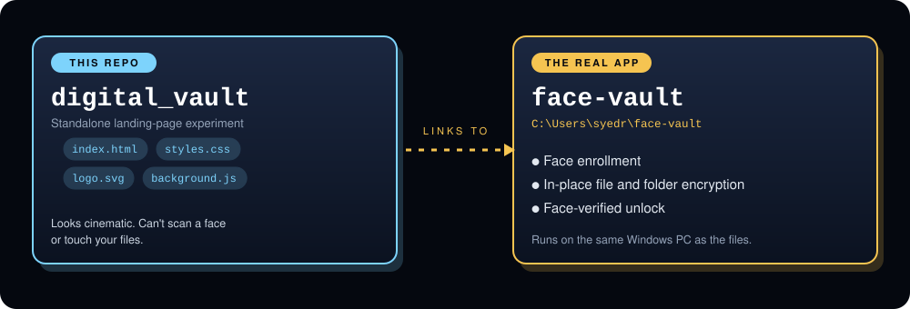
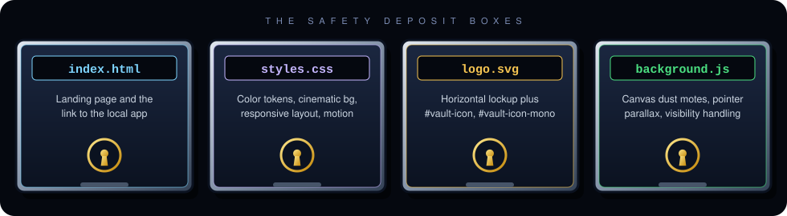
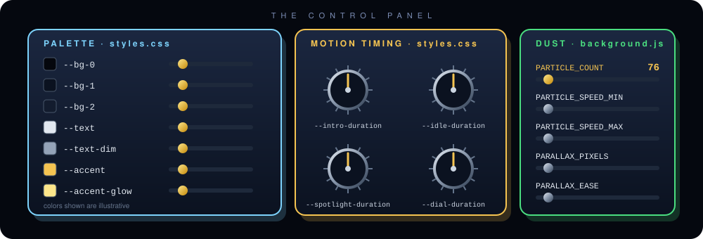
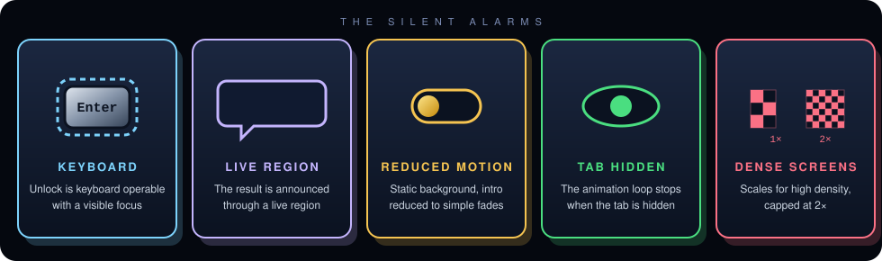
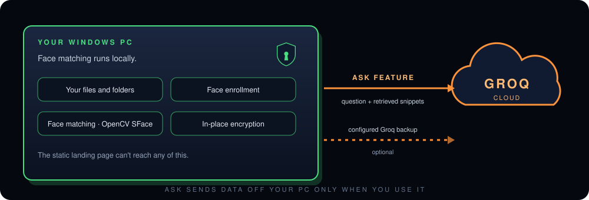

<!-- FACE_VAULT | VAULT DOOR README -->

<div align="center">



<a href="https://github.com/SyedRaqi/digital_vault">
  
</a>

<br/>

<a href="#-two-vaults-one-story"></a>
&nbsp;
<a href="#-the-unlock-sequence"></a>
&nbsp;
<a href="#%EF%B8%8F-the-fine-print"></a>

<br/><br/>


</div>


## 🔐 The Vault Door

> **Read this before you knock.**
> The unified, functional Face Vault app, including its cinematic entrance and working file/folder protection, lives in `C:\Users\syedr\face-vault`. Run that app directly. **This folder contains the standalone visual landing-page experiment only.**

Face Vault is built around one idea: **your face is the key.** Enroll a face, encrypt files and folders in place, and unlock them only when your face is verified. What you're looking at here is the front door, the cinematic landing page that sets the mood and links to the local application.

## 🏛️ Two Vaults, One Story

<div align="center">

</div>

<br/>

| | 🏠 `digital_vault` (this repo) | 🔒 `face-vault` (the real app) |
|---|---|---|
| **What it is** | The standalone landing-page experiment | The unified, functional Face Vault app |
| **Where it lives** | This repository | `C:\Users\syedr\face-vault` |
| **Can it scan a face?** | No | Yes: face enrollment and face-verified unlock |
| **Can it touch your files?** | No | Yes: in-place file and folder encryption |

## 🗄️ The Safety Deposit Boxes

<div align="center">

</div>

<br/>

- **`index.html`**: Face Vault landing page and link to the local application.
- **`styles.css`**: color tokens, cinematic background, responsive layout, and motion.
- **`logo.svg`**: standalone horizontal lockup. It also defines reusable icon-only (`#vault-icon`) and monochrome (`#vault-icon-mono`) SVG symbols.
- **`background.js`**: canvas dust motes, pointer parallax, and visibility handling.

The animated page mark is inline SVG in `index.html`, so its shield, rings, and keyhole can animate independently. `logo.svg` is the convenient standalone brand asset. The SVG uses a 120 × 136 icon viewBox and scales cleanly for small and large use.

## 🎛️ The Control Panel

<div align="center">

</div>

<br/>

**Palette.** Edit the custom properties at the top of `styles.css` to change the palette. The main controls are `--bg-0`, `--bg-1`, `--bg-2`, `--text`, `--text-dim`, `--accent`, and `--accent-glow`. The matching metallic logo stops and gold keyhole are in `logo.svg` and the inline SVG in `index.html`.

**Timing.** Change `--intro-duration`, `--idle-duration`, `--spotlight-duration`, or `--dial-duration` in `styles.css` to adjust the CSS motion timing. Individual intro beats and hover effects have their own delays and durations alongside their keyframes.

**Dust.** Set `PARTICLE_COUNT`, `PARTICLE_SPEED_MIN`, and `PARTICLE_SPEED_MAX` in the `CONFIG` object near the top of `background.js` to tune the dust layer. The particle count defaults to 76. Parallax travel and easing are controlled by `PARALLAX_PIXELS` and `PARALLAX_EASE` there.

<div align="center">

</div>

## ♿ The Silent Alarms

<div align="center">

</div>

<br/>

The unlock control is keyboard operable, has a visible focus treatment, and announces the resulting state through a live region. The page mark has an accessible name and title. Users who enable reduced motion get a static background with the intro reduced to simple fades; canvas particles and pointer parallax are disabled. The canvas stops its animation frame loop when the tab is hidden and scales for high-density screens, capped at 2× for a light memory footprint.


## 🔓 The Unlock Sequence

<div align="center">

</div>

<br/>

To run the unified app, open PowerShell and run:

```powershell
cd C:\Users\syedr\face-vault
.\.venv\Scripts\python.exe -m streamlit run streamlit_app.py --server.port 8000
```

Then visit `http://localhost:8000`. The app supports face enrollment, in-place file/folder encryption, and face-verified unlock. **Run it on the same Windows PC as the files.**

The static landing-page preview cannot itself scan a face or access arbitrary files. Those capabilities belong to the unified local Face Vault application.

## 🛰️ Where Your Data Goes

<div align="center">

</div>

<br/>

Face matching is performed locally with OpenCV SFace; the app can also use its configured Groq backup. The **Ask** feature sends your question and retrieved snippets to Groq when used.

## ⚠️ The Fine Print

<div align="center">

</div>

<br/>

Review `C:\Users\syedr\face-vault\README.md` and its security limitations before protecting important files. Face Vault is a personal project and is not a substitute for a security-audited backup and encryption solution.

## 📝 Design Notes

The design uses a perspective line grid instead of a hexagonal lattice, keeping the depth cue quiet and legible behind the central mark. The page uses the system font stack so it remains fully offline.

## 📜 License

Released under the [Unlicense](LICENSE).

<div align="center">



**FACE_VAULT** · Built by [Syed Raqi](https://github.com/SyedRaqi) · [⭐ Star the repo](https://github.com/SyedRaqi/digital_vault)

<sub>The landing page for Face Vault, a digital vault for securing and encrypting files and folders.</sub>

</div>
